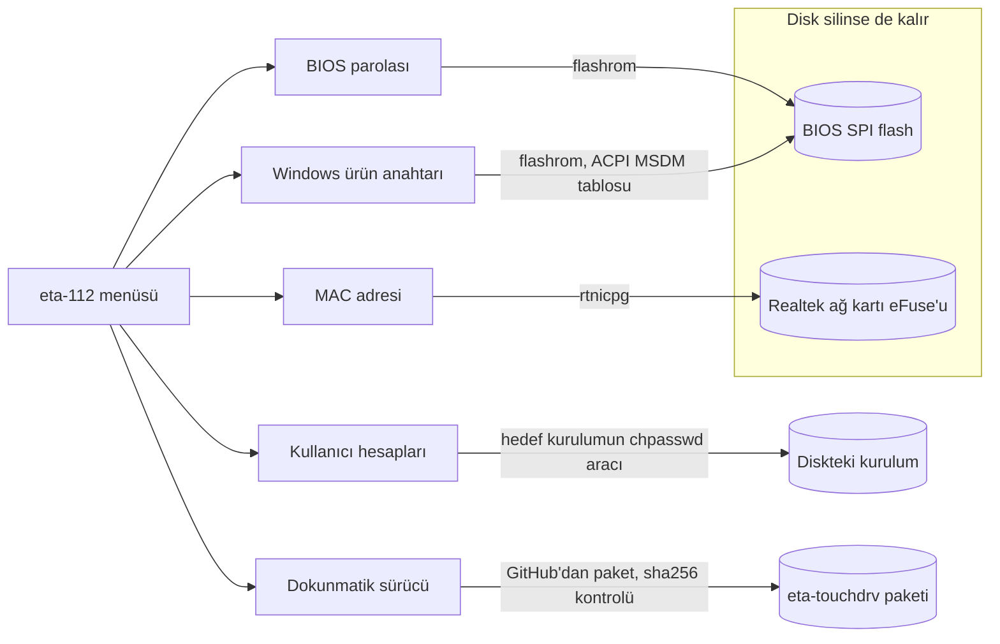

# ETA-112

[](LICENSE)


Pardus ETAP akıllı tahtalarda kullanıcı hesaplarının parolasını sıfırlar; BIOS
parolasını, MAC adresini ve Windows ürün anahtarını okur ve değiştirir. Dokunmatik
kalibrasyon sorununu düzelten sürücü sürümünü bulmaya da yardım eder. Kurulum
gerektirmez, canlı (USB) ortamdan da çalışan sistemden de tek komutla açılır.

Bu depo yalnızca Linux içindir. BIOS/EEPROM işlevlerini Windows üzerinde
kullanacaksanız [eta-112-win](https://github.com/enseitankado/eta-112-win) deposuna
bakın.

## Hızlı başlangıç

Aşağıdaki komutu kopyalayıp bir terminale yapıştırın:

```bash
curl -fsSL https://raw.githubusercontent.com/enseitankado/eta-112/main/baslat.sh | sudo bash
```

Bilmeniz gereken en az şey:

- Araç root ister, bu yüzden komut `sudo` ile çalışır.
- Açılan menüde ok tuşlarıyla gezinip Enter ile seçersiniz. 1-9 tuşları doğrudan
  seçer, alt menüde Esc geri götürür, ana menüde Esc'ye art arda iki kez basmak
  programı kapatır.
- Ana menüde üç bölüm var: Kullanıcı hesapları, BIOS EEPROM ve Dokunmatik sürücü
  (Deneysel).
- Menüsüz kullanım da var, örneğin `curl ... | sudo bash -s -- bios info`.
  Ayrıntısı [kılavuzun Notlar bölümünde](KILAVUZ.md#notlar).

Her menünün ekran görüntüsü ve adım adım anlatımı
[KILAVUZ.md](KILAVUZ.md#çalıştırma) dosyasında.

## Neyi nereye yazar

Her işlev farklı bir yere dokunur. BIOS flash'ı ve ağ kartının eFuse'u diskten
bağımsızdır; disk silinse ya da değişse de oraya yazılan kalır.



BIOS'a yazan işlemler önce flash'ı okur, yalnızca gereken baytları değiştirir, yazar
ve sonra geri okuyup doğrular. MAC yazımı da geri okunarak doğrulanır.

## Desteklenen donanımlar

BIOS parolası, MAC adresi ve Windows ürün anahtarı işlevleri yalnızca bu modellerde
çalışır. Model tanınmazsa araç işlem yapmaz.

<!-- DESTEKLENEN-DONANIM:START (otomatik üretilir — tablo biçimi; elle düzenlemeyin) -->
| Faz / Model | Anakart | İşlemci | BIOS | Adet | Oran |
|---|---|---|---|--:|--:|
| **Faz 1 Vestel Intel (Siyah)** | VESTEL 14MB24A | Intel Core i3-2310M | AMI Aptio 4.6.5 | 60.180 | %11,19 |
| **Faz 2 Vestel AMD (Gri)** | VESTEL 14MB37C1 | AMD A10-5750M | AMI Aptio L0.30 | 53.733 | %9,99 |
| **Faz 2 Vestel Intel (Gri)** | VESTEL 14MB57 | Intel Core i3-4000M | AMI Aptio 4.6.5 | 205.399 | %38,18 |
<!-- DESTEKLENEN-DONANIM:END -->

## Başlamadan önce

- MAC adresi ağ kartının eFuse'una yazılır; yazma hakkı sınırlıdır ve geri alınamaz
  ([ayrıntı](KILAVUZ.md#bios-eeprom--mac-adresi)).
- BIOS parolası değişikliği flash'a yazılır ve ancak yeniden başlatınca etkili olur
  ([ayrıntı](KILAVUZ.md#bios-eeprom--bios-parolası)).
- Windows ürün anahtarı yalnızca MSDM tablosu olan cihazlarda okunur ve değişir;
  etkili olması için yeniden başlatma gerekir
  ([ayrıntı](KILAVUZ.md#bios-eeprom--windows-ürün-anahtarı)).
- Dokunmatik sürücü bölümü deneyseldir; dokunmatiği çalışmaz hale getirebilir ya da
  kalibrasyonu bozabilir ([ayrıntı](KILAVUZ.md#dokunmatik-sürücü)).
- Panel kalibrasyonunu okuma yöntemi doğrulanmıştır ama yazma komutu doğrulanmamıştır
  ([ayrıntı](KILAVUZ.md#kalibrasyonu-cihazdan-okuma)).

## Belgeler

| Belge | İçerik |
|---|---|
| [KILAVUZ.md](KILAVUZ.md) | Tüm menüler, ekran görüntüleri ve komut satırı örnekleri |
| [Kullanıcı hesapları](KILAVUZ.md#kullanıcı-hesapları) | Kurulu sistemdeki bir hesabın parolasını sıfırlama |
| [BIOS EEPROM](KILAVUZ.md#bios-eeprom) | BIOS parolası, MAC adresi ve Windows ürün anahtarı |
| [Dokunmatik sürücü](KILAVUZ.md#dokunmatik-sürücü) | Sürüm deneme, kalibrasyon okuma ve ekrandan kalibrasyon |
| [dokunmatik/README.md](dokunmatik/README.md) | Sürücü arşivi, sürüm matrisi ve deneme sırası |
| [Kalibrasyon protokolü](dokunmatik/belgeler/kalibrasyon-protokolu.md) | Kalibrasyonu cihazdan okuma/yazma protokolü ve kesinlik dökümü |
| [Dokunmatik mimarisi](dokunmatik/belgeler/mimari.md) | ETAP OTD dokunmatik ekranın sistem mimarisi |

## Katkı

`eta-112.py` dosyasını değiştirdiyseniz `./gom.sh` çalıştırın. `baslat.sh` Python
kaynağını içinde gömülü taşır; çalıştırmazsanız iki kopya birbirinden ayrışır.
`./gom.sh --kontrol` yalnızca gömülü kopyanın güncel olup olmadığını söyler.

## Bir ricam

Araç işinizi gördüyse GitHub'da yıldız bırakın. Aynı sorunu yaşayan başka birinin
depoyu bulmasını kolaylaştırıyor.

## Geliştirici ve lisans

- Geliştirici: Özgür Koca, [ozgurkoca.com](https://ozgurkoca.com)
- Lisans: [GPL-3.0-or-later](LICENSE), özgür yazılım.
